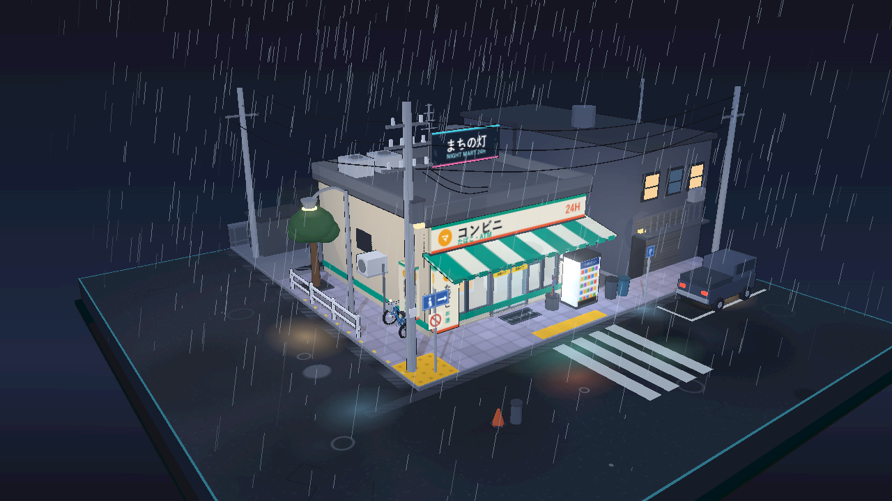

# 雨夜便利店街角 · Rainy Night Corner Store

一个可自由拖拽 / 旋转 / 缩放观看的**雨夜日式便利店街角微缩三维模型**。
纯前端实现（three.js r128 + WebGL），无 UI 界面元素，打开即进入第三人称观察视角。



## 运行

**双击 `index.html` 即可**（全部依赖已本地化到 `vendor/`，无需联网、无需起服务器）。

如需在浏览器标签页中运行，也可以：

```bash
python -m http.server 8000     # 然后访问 http://localhost:8000
```

## 操作

| 操作 | 效果 |
| --- | --- |
| 左键拖拽 | 环绕旋转（阻尼平滑） |
| 滚轮 / 双指 | 缩放 |
| 右键拖拽 / 双指拖动 | 平移 |

页面加载后会播放约 6 秒的**入场组装动画**：模型从底座地面开始，逐层向上叠加生长
（底座 → 路面 → 人行道 → 墙体 → 橱窗 → 内部 → 雨棚 → 招牌 → 屋顶 → 街边道具），
同时镜头由远及近推入。任意鼠标操作会立即接管镜头。

## 场景内容

- **便利店主体**：便利店招牌（发光灯箱 + 竖向袖看板「たばこ / お酒」）、玻璃橱窗、
  **自动感应门**（会定时开合，贴有「自動ドア」标识）、条纹屋檐雨棚 + 棚下灯带、
  门口地垫（いらっしゃいませ）、空调外机、屋顶水箱/空调机组/屋顶广告牌
- **室内**：货架与彩色商品、收银台、面包保温柜、杂志架、冷藏柜、荧光灯管、营业中吊牌
- **街道**：自动贩卖机、**自行车**（两辆）、**雨伞架**（5 把伞）、**垃圾桶**（两只）、
  **路灯**、**电线杆**（三根 + 变压器 + 绝缘子）、**悬垂电线**、**路牌**（人行横道指示牌 +
  禁停牌 + 停车 P 牌）、**街角护栏**、**停车位**（含停靠的轻卡）、**排水沟**箅子、
  **积水路面**（实时镜面反射 + 霓虹拖影）、**反光斑马线**、**小巷入口**、
  **公告栏 / 海报栏**、行道树、盲道（点字ブロック）、交通锥
- **右侧旧楼**：卷帘门、二层亮窗、阳台栏杆、外挂空调与屋顶水箱

## 视觉技术

- **三渲二（cel shading）**：`MeshToonMaterial` + 4 阶色阶贴图
- **描边**：反向外扩壳（inverted hull），为主要体块加统一深色轮廓线
- **夜景霓虹**：自发光材质 + `UnrealBloomPass` 辉光（半分辨率）+ 伽马校正输出
- **湿地面**：`Reflector` 平面镜实时反射 + 半透明湿柏油层（积水处透出反射）
- **雨**：1200 条 GPU 着色器雨丝（带风偏斜，落到屋檐 / 屋顶以下会自动隐去）+
  地面涟漪 shader（与柏油贴图里的积水一一对应）+ 霓虹倒影拖影
- **色彩管线**：r128 处于 legacy 模式，材质色 / 雾色统一做 sRGB→Linear 转换，
  末端经自写伽马 pass 还原，屏幕所见即代码所写
- **阴影**：单向光阴影贴图 2048²，场景静止后不再重算（只在组装动画期间刷新），
  比每帧重画快 ~30%

## 目录

```
index.html          入口（classic script，双击即开）
js/lib.js           工具层：色阶 / 材质工厂 / 描边 / 程序化贴图 / 动画曲线
js/world.js         底座、路面、人行道、街道设施、邻楼与小巷
js/shop.js          便利店主体、橱窗、自动门、雨棚招牌、室内、屋顶、贩卖机
js/props.js         自行车、雨伞架、垃圾桶、轻卡、行道树、巷子杂物
js/rain.js          雨、涟漪、霓虹拖影、自动门与灯牌待机动画
js/main.js          渲染器 / 相机 / 灯光 / 后处理 / 入场组装动画 / 主循环
vendor/             three.js r128 及所需 example（已本地化，离线可用）
tools/              开发用：Node 场景自检 + 无头浏览器截图脚本
output/             预览渲染图
```

## 可选调试参数

| 参数 | 作用 |
| --- | --- |
| `?dpr=0.5` | 降低渲染分辨率（软件渲染 / 低端机） |
| `?probe=1` | 在页面标题显示帧率、可见部件数等运行状态 |
| `?still=9` | 固定时间点（跳过入场动画），用于截图对比；`6` = 门打开，`9` = 门关闭 |
| `?rain=0` | 关闭雨，方便单独检查场景 |
| `?shadow=always` | 每帧重算阴影贴图（默认只在场景变化时重算） |

## 开发脚本

```bash
node tools/inspect.js        # 在 Node 里搭一遍场景，检查部件 / 网格数
node tools/shot.js --out output/shot.png --wait 12000 \
     --url "file:///.../index.html?still=9" \
     --eval "window.__dio.setCam(1.2,2.4,10.2, 0.8,1.7,2.0)"
node tools/pixel.js output/shot.png 640,360     # 取色
node tools/pixel.js output/shot.png --crop 260,420,520,220,2 output/crop.png   # 裁剪放大
```

## 环境

- three.js r128（本地 vendor，无需联网）
- 无构建步骤、无 npm 运行时依赖
- 开发期可选：`npm i`（仅用于 tools/ 下的自检与截图脚本）
